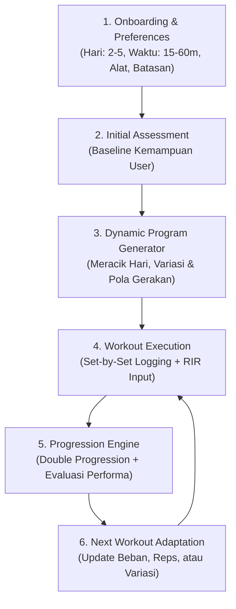

# Roadmap Implementasi: Adaptive Home Fitness Coach

Berdasarkan dokumen spesifikasi produk terbaru di [`docs/new_target.md`](file:///d:/ADI/aplikasi-olahraga/docs/new_target.md), aplikasi beralih dari *static calendar split* menjadi **Adaptive Fitness Coach berbasis performa nyata**. 

Sistem dirancang **100% fleksibel** (tidak terkunci pada angka 3 hari atau format statis tertentu), di mana program di-generate secara dinamis berdasarkan data Onboarding dan dievaluasi terus-menerus oleh Progression Engine.

---

## Prinsip Utama Produk (Core Product Principle)

> **"Build a training system that gets better at guiding users as it learns from their actual training history."**  
> *(Membangun sistem latihan yang semakin pintar dan presisi memandu pengguna seiring sistem mempelajari riwayat performa nyata mereka).*

---

## Definisi Keberhasilan Produk (Definition of Product Success)

Aplikasi ini **tidak dianggap sukses hanya karena bisa men-generate jadwal latihan**. 

Produk ini terbukti berhasil jika memenuhi indikator nyata berikut:
1. **Beginners can start training without confusion**: Pemula bisa langsung mulai latihan tanpa rasa bingung, takut salah, atau terbebani.
2. **Users complete their planned workouts**: Pengguna benar-benar menuntaskan sesi latihan yang telah direncanakan (durasi realistis & beban pas).
3. **Progression recommendations are understandable**: Rekomendasi kenaikan/penyesuaian beban dari Coach Adi mudah dipahami alasan di baliknya (*transparent & human-like*).
4. **Training adjustments are appropriate**: Penyesuaian latihan tepat sasaran—tidak terlalu agresif hingga bikin cedera/kapok, dan tidak terlalu stagnan hingga bikin bosan.
5. **Users continue using the product over multiple weeks**: Pengguna bertahan dan konsisten membuka aplikasi selama berminggu-minggu (*retention by trust*).
6. **Performance improvements can be measured**: Peningkatan kekuatan, repetisi, dan penguasaan teknik pengguna dapat diukur dan dilihat secara nyata (*tangible progress*).

---

## Arsitektur Alur Sistem (End-to-End Flow)



---

## Blueprint Skema Database Relasional & Adaptif

Skema ini menjadi standar arsitektur data permanen kita (SQLite lokal + Supabase cloud) untuk mendukung seluruh siklus latihan adaptif:

```sql
PRAGMA foreign_keys = ON;

-- 1. Pengguna & Preferensi Latihan (Fleksibel Hari & Waktu)
CREATE TABLE users (
    id TEXT PRIMARY KEY,
    email TEXT,
    created_at TEXT NOT NULL,
    updated_at TEXT NOT NULL
);

CREATE TABLE user_profiles (
    user_id TEXT PRIMARY KEY,
    goal TEXT NOT NULL,
    experience_level TEXT NOT NULL,
    preferred_duration INTEGER,
    weekly_frequency INTEGER NOT NULL DEFAULT 3,
    timezone TEXT,
    training_limitations TEXT,
    FOREIGN KEY (user_id) REFERENCES users(id)
);

-- 2. Master Gerakan & Tangga Progresi
CREATE TABLE exercises (
    id TEXT PRIMARY KEY,
    name_id TEXT NOT NULL,
    name_en TEXT NOT NULL,
    category TEXT NOT NULL,
    stage TEXT NOT NULL DEFAULT 'main', -- 'warmup', 'main', 'cooldown'
    difficulty TEXT NOT NULL DEFAULT 'beginner',
    movement_pattern TEXT NOT NULL, -- horizontal_push, squat, hinge, etc.
    primary_muscles TEXT NOT NULL, -- JSON array
    stabilizer_muscles TEXT NOT NULL, -- JSON array
    equipments TEXT NOT NULL, -- JSON array
    steps_id TEXT NOT NULL,
    steps_en TEXT NOT NULL,
    start_pose_asset TEXT,
    end_pose_asset TEXT,
    animation_asset TEXT,
    video_url TEXT,
    is_active INTEGER NOT NULL DEFAULT 1,
    created_at TEXT NOT NULL,
    updated_at TEXT NOT NULL
);

-- Peta Tangga Evolusi Gerakan (Wall -> Knee -> Standard -> Diamond Push Up)
CREATE TABLE exercise_progressions (
    id TEXT PRIMARY KEY,
    from_exercise_id TEXT NOT NULL,
    to_exercise_id TEXT NOT NULL,
    progression_type TEXT NOT NULL, -- 'difficulty_increase', 'variation_switch'
    min_success_sessions INTEGER NOT NULL DEFAULT 2,
    FOREIGN KEY (from_exercise_id) REFERENCES exercises(id),
    FOREIGN KEY (to_exercise_id) REFERENCES exercises(id)
);

-- 3. Program Dinamis & Resep Latihan (Bisa N Hari / Minggu)
CREATE TABLE training_programs (
    id TEXT PRIMARY KEY,
    user_id TEXT NOT NULL,
    name TEXT NOT NULL,
    status TEXT NOT NULL, -- 'active', 'completed', 'archived'
    start_date TEXT NOT NULL,
    end_date TEXT,
    weekly_frequency INTEGER NOT NULL DEFAULT 3,
    FOREIGN KEY (user_id) REFERENCES users(id)
);

CREATE TABLE program_sessions (
    id TEXT PRIMARY KEY,
    program_id TEXT NOT NULL,
    day_number INTEGER NOT NULL, -- 1, 2, ... N
    name TEXT NOT NULL, -- 'Session A', 'Full Body 1', etc.
    target_duration_minutes INTEGER NOT NULL DEFAULT 30,
    FOREIGN KEY (program_id) REFERENCES training_programs(id)
);

CREATE TABLE program_exercises (
    id TEXT PRIMARY KEY,
    program_session_id TEXT NOT NULL,
    exercise_id TEXT NOT NULL,
    sort_order INTEGER NOT NULL,
    stage TEXT NOT NULL DEFAULT 'main', -- 'warm_up', 'main', 'cool_down'
    target_sets INTEGER NOT NULL,
    min_reps INTEGER NOT NULL,
    max_reps INTEGER NOT NULL,
    target_rir INTEGER, -- target Reps In Reserve (misal 1-2)
    rest_seconds INTEGER NOT NULL DEFAULT 60,
    FOREIGN KEY (program_session_id) REFERENCES program_sessions(id),
    FOREIGN KEY (exercise_id) REFERENCES exercises(id)
);

-- 4. Eksekusi Latihan Aktual & Tracking Set-by-Set
CREATE TABLE workout_sessions (
    id TEXT PRIMARY KEY,
    user_id TEXT NOT NULL,
    program_id TEXT,
    program_session_id TEXT,
    scheduled_date TEXT NOT NULL,
    started_at TEXT,
    completed_at TEXT,
    actual_duration INTEGER,
    status TEXT NOT NULL, -- 'in_progress', 'completed', 'skipped'
    FOREIGN KEY (user_id) REFERENCES users(id),
    FOREIGN KEY (program_id) REFERENCES training_programs(id),
    FOREIGN KEY (program_session_id) REFERENCES program_sessions(id)
);

CREATE TABLE workout_exercises (
    id TEXT PRIMARY KEY,
    workout_session_id TEXT NOT NULL,
    exercise_id TEXT NOT NULL,
    sort_order INTEGER NOT NULL,
    FOREIGN KEY (workout_session_id) REFERENCES workout_sessions(id),
    FOREIGN KEY (exercise_id) REFERENCES exercises(id)
);

CREATE TABLE exercise_sets (
    id TEXT PRIMARY KEY,
    workout_exercise_id TEXT NOT NULL,
    set_number INTEGER NOT NULL,
    target_reps INTEGER,
    actual_reps INTEGER,
    actual_load REAL,
    rir INTEGER, -- Reps in Reserve aktual (0, 1, 2, 3, 4+)
    form_score REAL,
    is_warmup INTEGER NOT NULL DEFAULT 0,
    data_source TEXT NOT NULL DEFAULT 'manual', -- 'manual', 'camera_pose', 'wearable'
    FOREIGN KEY (workout_exercise_id) REFERENCES workout_exercises(id)
);

-- 5. Audit Log Keputusan Otak Coach / Progression Engine
CREATE TABLE progression_decisions (
    id TEXT PRIMARY KEY,
    user_id TEXT NOT NULL,
    exercise_id TEXT NOT NULL,
    decision TEXT NOT NULL, -- 'Progress', 'Maintain', 'Regress', 'Recover'
    previous_prescription TEXT, -- JSON snapshot resep lama
    next_prescription TEXT,     -- JSON snapshot resep baru
    reason TEXT NOT NULL,       -- Penjelasan transparan dari Coach Adi
    created_at TEXT NOT NULL,
    FOREIGN KEY (user_id) REFERENCES users(id),
    FOREIGN KEY (exercise_id) REFERENCES exercises(id)
);

-- Indexing Performa Kueri Cepat
CREATE INDEX idx_workout_sessions_date ON workout_sessions(scheduled_date);
CREATE INDEX idx_workout_exercises_session ON workout_exercises(workout_session_id);
CREATE INDEX idx_exercise_sets_workout ON exercise_sets(workout_exercise_id);
CREATE INDEX idx_progression_decisions_user ON progression_decisions(user_id, exercise_id);
```

---

## Rincian 5 Fase Implementasi

### 📌 Fase 1: User Profile & Onboarding Engine (Pondasi Fleksibilitas)
> **Tujuan**: Menangkap profil dan ketersediaan waktu user secara presisi agar program tidak pernah memaksakan jadwal kaku.

* **Tabel Terkait**: `users`, `user_profiles`.
* **Fitur & Logika**:
  - Multi-step onboarding interaktif yang bersih dan cepat.
  - Pilihan frekuensi mingguan (`weekly_frequency`: 2, 3, 4, 5 hari).
  - Pilihan durasi fleksibel (`preferred_duration`: 15, 20, 30, 45, 60 menit).
  - Input batasan fisik & ketersediaan alat.
  - Initial assessment test (uji kemampuan dasar untuk menentukan titik awal pada tangga `exercise_progressions`).

---

### 📌 Fase 2: Dynamic Program Generator & Movement Matrix
> **Tujuan**: Menghasilkan jadwal dan daftar latihan harian yang otomatis beradaptasi dengan profil user dan durasi waktu yang dipilih.

* **Tabel Terkait**: `training_programs`, `program_sessions`, `program_exercises`, `exercise_progressions`.
* **Fitur & Logika**:
  - **Dynamic Session Creator**: Men-generate sejumlah sesi sesuai `weekly_frequency` user (2 hari $\to$ Sesi 1 & 2; 3 hari $\to$ Sesi A, B, C; dst).
  - **Movement Pattern Balancing**: Memastikan seluruh 8 pola dasar (*Horizontal Push/Pull, Vertical Push/Pull, Squat, Hinge, Lunge, Core*) terdistribusi proporsional dalam seminggu.
  - **Flexible Duration Filter**:
    - **15–20 Menit**: 2–3 gerakan majemuk inti.
    - **30–45 Menit**: 4–5 gerakan inti + variasi pendukung.
    - **60 Menit**: Full session komprehensif (Warm up, Main training, Cool down).

---

### 📌 Fase 3: Workout Execution & Set-by-Set RIR Tracking
> **Tujuan**: Menangkap data latihan aktual per set secara detail untuk menjadi bahan evaluasi cerdas.

* **Tabel Terkait**: `workout_sessions`, `workout_exercises`, `exercise_sets`.
* **Fitur & Logika**:
  - UI Active Workout interaktif dengan pencatatan `actual_reps` dan `actual_load`.
  - Input selector **RIR** (Reps in Reserve: 0, 1, 2, 3, 4+) yang mudah dipahami pemula di setiap akhir set.
  - Rest timer otomatis dengan sinyal haptik/audio.
  - Dukungan multi-stage: `stage` ('warm_up', 'main', 'cool_down') sesuai ketersediaan data program.

---

### 📌 Fase 4: Progression Engine & Decision Matrix (Otak Coach Adi)
> **Tujuan**: Menggantikan peran pelatih pribadi dengan domain service deterministik yang objektif, aman, dan transparan.

* **Arsitektur**: **Pure Domain Service** terpisah total dari database dan UI (100% testable & deterministic).
* **Tabel Terkait**: `progression_decisions`, `exercise_progressions`.

#### Input Engine:
- `Exercise prescription` (target sets, min_reps, max_reps, target_rir).
- `Workout performance` (actual sets completed, actual reps per set, load).
- `RIR` (Reps In Reserve: 0, 1, 2, 3, 4+).
- `Exercise quality` (form score / penilaian kerapian gerakan).
- `Recovery feedback` (tingkat kelelahan, indikasi nyeri/sakit).
- `Performance history` (riwayat konsistensi sesi-sesi sebelumnya).

#### Output Engine (Keputusan):
- **`Progress`**: Naikkan repetisi, tambah beban, atau naik ke variasi gerakan berikutnya via `exercise_progressions`.
- **`Maintain`**: Pertahankan target resep saat ini untuk mematangkan kestabilan postur tubuh.
- **`Regress`**: Turunkan ke variasi yang lebih ringan jika repetisi gagal atau terlalu berat.
- **`Recover`**: Turunkan volume latihan (deload) jika terdeteksi kelelahan kumulatif atau nyeri sendi.
- **`Reassess`**: Minta sesi uji ulang jika data penting tidak lengkap/meragukan.

#### Contoh Payload Keputusan:
```json
{
  "exercise_id": "incline_push_up",
  "decision": "progress",
  "reason": "Target reps achieved with appropriate effort",
  "next_target": {
    "sets": 2,
    "min_reps": 8,
    "max_reps": 12
  }
}
```

#### Aturan & Safety Guard Ketat:
* **Prinsip Utama**: **Engine tidak boleh melakukan progression apabila data penting tidak tersedia atau tidak cukup dapat dipercaya.**
  - Jika data `RIR` kosong, set tidak lengkap, atau `form_score` meragukan $\to$ otomatis menghasilkan keputusan **`Reassess`** atau **`Maintain`**.
  - Jika `recovery_feedback` menunjukkan rasa sakit/nyeri tidak wajar $\to$ otomatis menghasilkan keputusan **`Recover`** (tidak boleh dipaksa naik).
* **Double Progression Logic**:
  1. *Step 1*: Naikkan repetisi bertahap dalam rentang `min_reps` hingga `max_reps`.
  2. *Step 2*: Setelah user konsisten mencapai `max_reps` dengan RIR aman (1–2) selama `min_success_sessions`, picu kenaikan variasi gerakan via `exercise_progressions` atau tambah beban.
* **Transparent Reason**: Setiap keputusan wajib mencantumkan alasan yang jelas dan manusiawi pada kolom `reason` untuk ditampilkan oleh Coach Adi.

---

### 📌 Fase 5: Workout History & Performance Analytics
> **Tujuan**: Memberikan visibilitas kemajuan fisik dan kekuatan yang nyata kepada pengguna.

* **Tabel Terkait**: Kueri agregasi dari `workout_sessions`, `exercise_sets`, dan `progression_decisions`.
* **Fitur & Logika**:
  - Total volume mingguan (Sets $\times$ Reps $\times$ Load per grup otot).
  - Grafik tren kekuatan (perkembangan repetisi dan kenaikan variasi gerakan).
  - Konsistensi latihan (Workout streak & weekly completion rate).
  - Dual Database Sync (100% offline-first di SQLite, background sync ke Supabase).

---

## Matriks Prioritas Eksekusi

| Fase | Komponen Utama | Database Tables | Output Nyata |
| :--- | :--- | :--- | :--- |
| **Fase 1** | Onboarding & User Profile | `users`, `user_profiles` | User bisa atur hari (2-5 hari), waktu (15-60m), & alat |
| **Fase 2** | Dynamic Program Generator | `training_programs`, `program_sessions`, `program_exercises`, `exercise_progressions` | Program latihan ter-generate dinamis sesuai profil |
| **Fase 3** | Set Logging & RIR Tracker | `workout_sessions`, `workout_exercises`, `exercise_sets` | Data set, reps aktual, & RIR tersimpan di database |
| **Fase 4** | Progression Engine | `progression_decisions`, `exercise_progressions` | Rekomendasi kenaikan beban/variasi otomatis dari Coach Adi |
| **Fase 5** | History & Analytics | Agregasi data sesi & set | Dashboard grafik kemajuan latihan & statistik volume |


---

## Catatan Keputusan Teknis & Batasan Arsitektur

Berikut adalah keputusan teknologi fundamental yang menjadi acuan ketat seluruh fase implementasi:

| Komponen Sistem | Pilihan Teknologi / Rekomendasi | Keterangan & Batasan |
| :--- | :--- | :--- |
| **Database** | **SQLite + Drift + Supabase** | SQLite lokal dengan Drift ORM/DAO (100% offline-first), background sync ke Supabase. |
| **State Management** | **Flutter Riverpod** | Arsitektur reactive, modular, dan decoupled dari UI. |
| **Progression Engine** | **Deterministic Dart Engine** | Pure Domain Service berbasis aturan resistance training (bukan black-box AI). |
| **Exercise Catalog** | **Structured Local Dataset** | Dataset lokal kaya metadata (biomekanika, equipment, stage, asset). |
| **AI / Machine Learning** | **Bukan Dependency MVP** | MVP berjalan deterministik; tidak ada ketergantungan API LLM cloud yang rapuh. |
| **Computer Vision** | **Native Android + MediaPipe** | Diimplementasikan pada fase berikutnya (P2 - Camera Form Analysis). |
| **LLM (AI Coach)** | **LiteRT-LM (On-Device)** | Diimplementasikan setelah kebutuhan coaching percakapan teruji nyata di lapangan. |

---

## 3 Syarat Mutlak Menuju Production (Definition of Done)

Tiga pekerjaan ini **belum boleh dianggap selesai** sebelum memenuhi standar berikut:

1. **Exercise Catalog Biomekanika & Equipment Valid**:
   Seluruh katalog gerakan harus memiliki metadata biomekanika (*movement pattern, primary muscles, stabilizer muscles, mechanics type*) dan syarat *equipment* yang benar secara sports science.
2. **Validasi Aturan Progression Engine**:
   Aturan *double progression*, penentuan repetisi, dan evaluasi RIR harus divalidasi ketat terhadap prinsip *resistance training* dan hasil pengujian pengguna nyata.
3. **Database Kesiapan Production**:
   Database wajib dilengkapi skema migrasi otomatis (*Drift migrations*), *user ownership & RLS*, pencatatan *feedback & recovery*, serta alur *initial assessment* yang solid sebelum rilis ke production.
